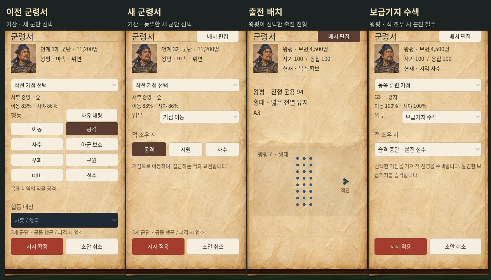
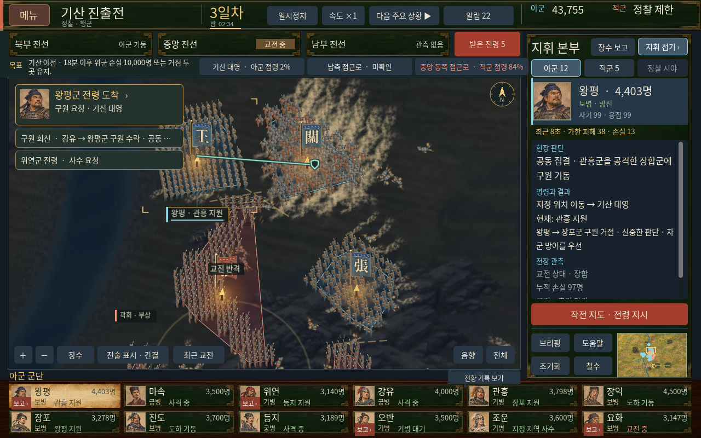

# 군략 Windows 데모 비교

[이번 판 다운로드 · 9a4833a](https://github.com/slows28/gunryak/raw/refs/heads/downloads/windows-9a4833a/Gunryak-Windows-9a4833a.zip)　[이전 판 다운로드 · 6038053](https://github.com/slows28/gunryak/raw/refs/heads/downloads/windows-6038053/Gunryak-Windows-6038053.zip)　[두 실행판의 코드 차이](https://github.com/slows28/gunryak/compare/6038053b697002d8904d9f727e13c83254bcc1d8...9a4833af923f52be4b16c72add449062d953a17a)

각 ZIP을 별도 폴더에 풀고 `Gunryak.exe`를 실행하세요. 같은 난이도의 **기산 진출전**에서 같은 군단에 중앙 거점 지시를 내려 보면 차이가 잘 보입니다.

| 비교할 점 | 이전 판 · 6038053 | 이번 판 · 9a4833a |
| --- | --- | --- |
| 출전 위치와 진형 | 부대별 작전과 행군 경로를 군령서에서 준비 | 배치 편집에서 한 군단이나 여러 군단을 끌어 위치를 지정. 장수가 그 자리에서 병종·임무·지형·진형 운용 능력에 따라 진형을 선택 |
| 군령서 | 행동과 협동 상대를 고르고 지시를 확정 | 적 조우 시 공격·지원·사수를 고르고 거점을 누르면 이동 지시 등록. 전투 중에는 전령이 도착하면 적용 |
| 주변 아군 지원 | 지정 연계와 기존 장수 AI로 지원 | 같은 지역의 피격 신호와 실제 시야에 따라 장수가 지원. 이미 측면 돌격에 들어간 기병은 그 기동을 이어감 |
| 보급기지 습격 | 공격적인 장수가 기회를 보고 습격 | 보급기지 수색을 직접 지시하고 적을 만났을 때 철수·속행 중 선택 |

## 기산에서 확인된 구원 장면

이번 판에서 아군 12개 군단에 중앙 거점 이동을 각각 지시했습니다. 3일차에 장합이 관흥을 공격하자 왕평이 구원 기동을 선택하고 장합을 직접 타격했습니다. 왕평의 협동 상대는 지정하지 않았습니다. 아래는 시드 137에서 관찰한 한 전투입니다.

같은 궁병의 진형 운용을 48과 92로 바꿔 비교했을 때 출전 진형은 각각 횡대와 안행진이었습니다. 같은 횡대에서 종대로 전환하는 데 각각 15.18작전초와 13.50작전초가 걸렸습니다. 자동 검사 30개를 통과했고 Windows 실행 파일은 Wine에서 출전·전투·복귀·종료를 확인했습니다.
